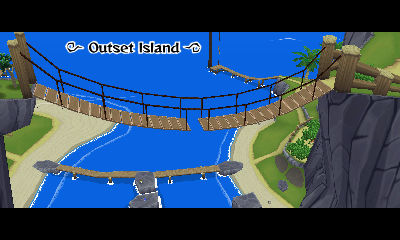
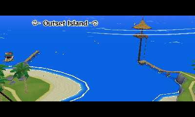
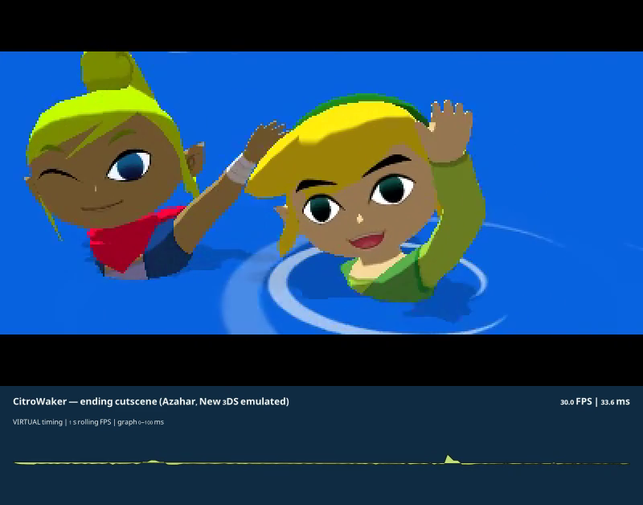

  

  <strong>A familiar sea. A new handheld home.</strong> 
  An experimental native port of <em>The Legend of Zelda: The Wind Waker</em> for the New Nintendo 3DS family.

  <a href="#the-project">The project</a> &nbsp; · &nbsp;
  <a href="#development-status">Status</a> &nbsp; · &nbsp;
  <a href="#getting-started">Getting started</a> &nbsp; · &nbsp;
  <a href="docs/DEVELOPMENT.md">Development guide</a>

> **In development.** Gameplay runs on real New 3DS hardware. Rendering, performance and stability work continues; full-game completion is unverified. This repository publishes documentation and showcase tools, with no downloadable game build yet.

## The project

CitroWaker brings Wind Waker's native game code to the **New Nintendo 3DS, New 3DS XL and New 2DS XL**. Built on the community decompilation, SwitchWaker and Aurora, it translates the game's GameCube graphics commands for the handheld's PICA GPU.

The goal is the original adventure with controls and presentation that belong on two screens. Previously known as **Project Windfall**.

<table>
<tr>
<td width="50%" align="center">
 
<strong>Back to Outset</strong> 
The island's rope bridge, running in the development build.
</td>
<td width="50%" align="center">
 
<strong>A sea worth exploring</strong> 
The coast and lookout at the port's native 400 × 240 output.
</td>
</tr>
</table>

Unmodified Azahar captures · November 12, 2026 · Emulator images do not establish real-console rendering correctness or performance.

## Built around the handheld

| Familiar adventure | Handheld controls | Two-screen presentation |
| :--- | :--- | :--- |
| Native game code and an original-game fidelity goal. | Circle Pad movement, C-stick camera and physical button remapping. | Live-map routing and customizable touch shortcuts, with panel integration still underway. |

Optional sailing, grappling, text and song-replay hooks are implemented in the development tree. **Gyro aiming is opt-in and still needs physical sensor validation.** Feature inclusion and validation vary by build.

[Controls & development guide →](docs/DEVELOPMENT.md#controls) &nbsp; · &nbsp; [QoL & gyro →](QOL.md) &nbsp; · &nbsp; [Touch shortcuts →](SHORTCUTS.md)

## Development status

| Area | Current state |
| :--- | :--- |
| **Game & audio** | Boots and reaches gameplay on real New 3DS; sound and physical controls run. |
| **Graphics** | Custom GX-to-PICA renderer. Console depth, cloud and other visual faults remain under investigation. |
| **Performance** | Heavy scenes need optimization. Hardware measurements guide the work; emulator FPS is reported separately. |
| **Saving** | SD-backed memory cards are implemented. Save-related failures have been reported; keep backups. |
| **Touch & QoL** | Development features with differing integration and validation status. Design previews are not proof of shipped functionality. |
| **Release** | Documentation, showcase images and an offline timing-overlay tool are available here. No CIA or self-contained port source release yet. |

[Measured performance →](docs/PERFORMANCE.md) &nbsp; · &nbsp; [Console findings →](docs/CONSOLE_FINDINGS.md)

### Where we're heading

1. **Correctness and stability:** resolve console rendering faults and save/transition failures.
2. **Every-frame performance:** reduce command decoding, memory traffic and draw preparation while preserving the game.
3. **A complete handheld interface:** finish the live map, touch shortcuts and context-aware bottom screen.

PC-side game-data preparation and a direct model-rendering path are being explored. They are development work, not promised speedups.

## Getting started

**There is no public build to download yet.** This page documents the project and the experimental builds already in testing; it is not a fresh-clone build of the port.

For a compatible experimental CIA you already have:

1. **Prepare your data.** Use your own USA GameCube disc image (`GZLE01`) and locally prepared bundles in `/3ds/ww3ds/`.
2. **Install the CIA.** Exit the installer and launch from the HOME Menu.
3. **Keep your saves.** Preserve `/3ds/ww3ds/user/` when updating.

The original 3DS and 2DS are not supported targets. The project supplies no ISO, extracted game assets or Nintendo music. Existing `ww3ds` data/configuration paths remain unchanged after the rename.

[Installation, data layout & prerequisites →](docs/DEVELOPMENT.md#installation)

## Beyond Outset

The ending cutscene also boots and renders in the port. This development capture includes a measured frame-time graph beneath the game picture.

  

Azahar capture · The displayed timing is emulator/virtual timing, not console FPS. The Ganondorf battle has not been captured.

The [Python + FFmpeg showcase tool](tools/showcase/README.md) adds timing graphs to existing footage. It distinguishes emulator, console and host measurements and does not invent timings from the video's frame rate.

## Follow the work

| For players | For developers |
| :--- | :--- |
| [Installation & controls](docs/DEVELOPMENT.md#installation) | [Development arrangement](docs/DEVELOPMENT.md#building-from-source) |
| [QoL & gyro settings](QOL.md) | [Performance measurements](docs/PERFORMANCE.md) |
| [Touch shortcut status](SHORTCUTS.md) | [Hardware findings](docs/CONSOLE_FINDINGS.md) |
| [Report an issue](https://github.com/AureoLightz/CitroWaker/issues) | [Timing-overlay tool](tools/showcase/README.md) |

Bug reports are most useful with the build identifier, console/emulator details, scene and reproduction steps. Review diagnostics for personal information; never attach an ISO or extracted game-data pack.

---

<strong>Built on the community's work</strong>

  <a href="https://github.com/zeldaret/tww">zeldaret/tww</a> &nbsp; · &nbsp;
  <a href="https://github.com/centollOS/SwitchWaker">SwitchWaker</a> &nbsp; · &nbsp;
  <a href="https://github.com/encounter/aurora">Aurora</a> &nbsp; · &nbsp;
  <a href="https://devkitpro.org/">devkitPro</a> &nbsp; · &nbsp;
  <a href="https://github.com/azahar-emu/azahar">Azahar</a>

The Legend of Zelda and The Wind Waker belong to Nintendo. CitroWaker is an independent community project, not affiliated with or endorsed by Nintendo. Screenshots contain game imagery; no licence over Nintendo assets is granted. See [repository scope and rights](RIGHTS.md).
