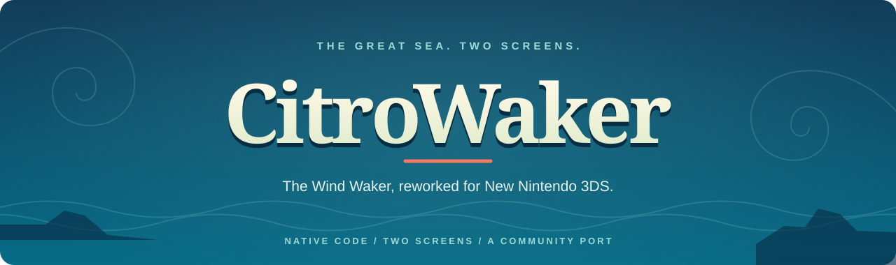
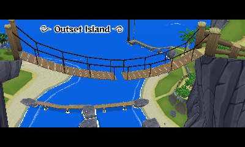
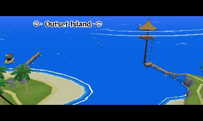
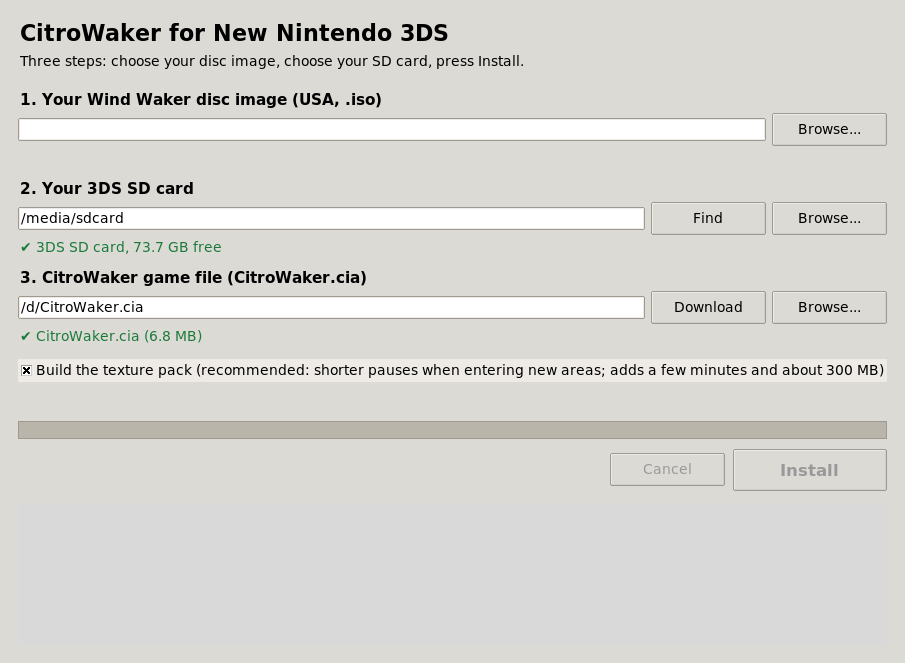
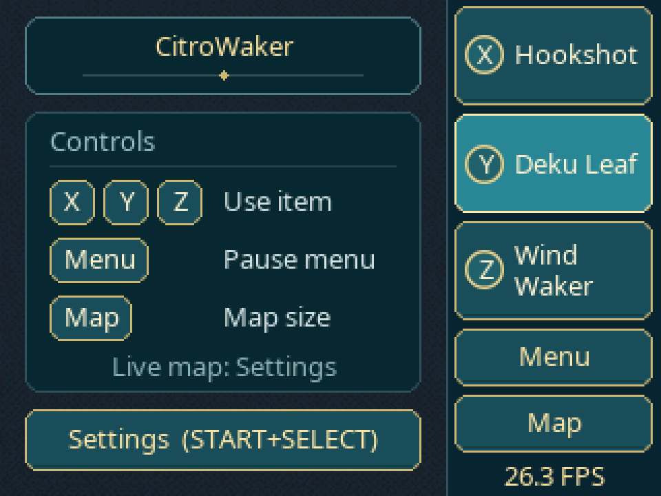
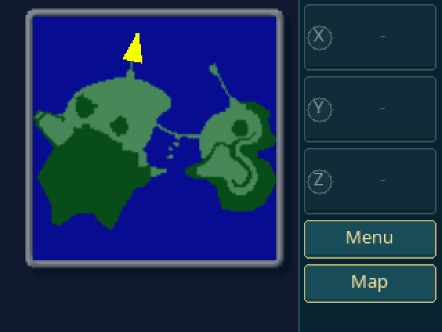
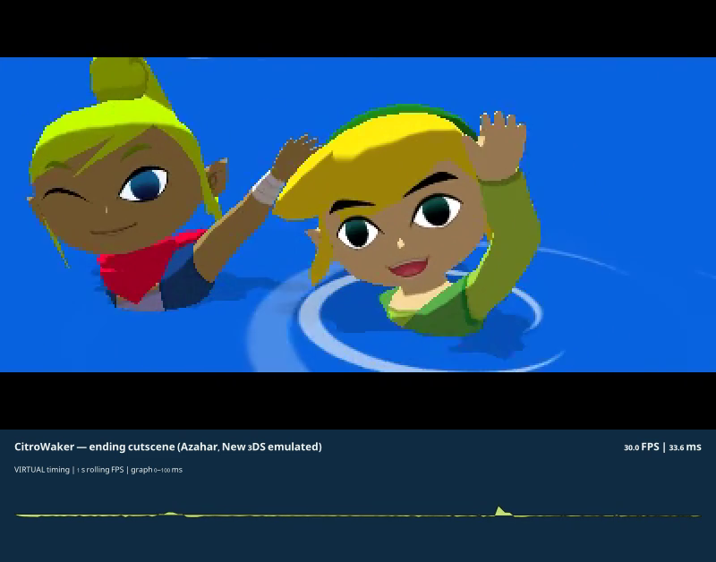

  

  <strong>A familiar sea. A new handheld home.</strong> 
  An experimental native port of <em>The Legend of Zelda: The Wind Waker</em> for the New Nintendo 3DS family.

  <a href="#install-in-three-steps"><b>Install</b></a> &nbsp; · &nbsp;
  <a href="#the-bottom-screen">Bottom screen</a> &nbsp; · &nbsp;
  <a href="#development-status">Status</a> &nbsp; · &nbsp;
  <a href="docs/PERFORMANCE.md">Performance</a> &nbsp; · &nbsp;
  <a href="docs/DEVELOPMENT.md">Development guide</a>

  
  
  
  

> **Early release.** Gameplay runs on real New 3DS hardware, with sound, saves and the touch screen. It is **not full speed yet** (heavy scenes run around 12 fps on console) and some console rendering faults remain; full-game completion is unverified. Keep backups of `/3ds/ww3ds/user/`.

## The project
*AI DISCLAIMER* Codex and Claude Code were used for a solid chunk of this, as a college student i literally do not have the time to do it all alone.

CitroWaker brings Wind Waker's native game code to the **New Nintendo 3DS, New 3DS XL and New 2DS XL**. Built on the community decompilation, SwitchWaker and Aurora, it translates the game's GameCube graphics commands for the handheld's PICA GPU.

The goal is the original adventure with controls and presentation that belong on two screens. Previously known as **Project Windfall**.

<table>
<tr>
<td width="50%" align="center">
 
<strong>Back to Outset</strong> 
The island's rope bridge, running in the development build.
</td>
<td width="50%" align="center">
 
<strong>A sea worth exploring</strong> 
The coast and lookout at the port's native 400 × 240 output.
</td>
</tr>
</table>

Unmodified Azahar captures · Emulator images do not establish real-console rendering correctness or performance.

## Install in three steps

You need a **New** 3DS / 3DS XL / 2DS XL with custom firmware and [FBI](https://github.com/Steveice10/FBI), and **your own** USA disc image of *The Wind Waker* (`GZLE01`, plain `.iso`). Nothing from the game is downloaded or included.

<table>
<tr>
<td width="55%">

1. **Download** the installer for your PC and `CitroWaker.cia` from [**Releases**](https://github.com/AureoLightz/CitroWaker/releases) into one folder.
2. **Run the installer**, choose your disc image, plug in the SD card (it is found automatically) and press **Install**. It checks your disc, copies everything to the card and can build the optional texture pack from your disc.
3. **On the 3DS**, open FBI › *SD* › *cia* › `CitroWaker.cia` › *Install CIA*, then start CitroWaker from the HOME Menu.

| PC | Download |
| :--- | :--- |
| Windows 10/11 | `CitroWaker-Installer.exe` |
| Linux x86-64 | `CitroWaker-Installer-linux-x86_64` |

Updating? Run the installer again: your saves in `/3ds/ww3ds/user/` are never touched and a disc image already on the card is not copied twice. [Installer details & command line →](installer/README.md)

</td>
<td width="45%" align="center">
 
The installer (Linux shown; Windows looks the same).
</td>
</tr>
</table>

The original 3DS and 2DS are not supported. Wrong-region, later-revision, trimmed or compressed (RVZ/CISO) images are rejected with instructions to fix them.

## The bottom screen

<table>
<tr>
<td width="50%" align="center">
 
<strong>Touch panel</strong> 
Touch X, Y or Z to use the assigned item, Menu for the pause menu, Settings for CitroWaker's options.
</td>
<td width="50%" align="center">
 
<strong>Live map</strong> 
Optional: the game's minimap drawn on the bottom screen (<i>Settings › Bottom screen</i>).
</td>
</tr>
</table>

Buttons follow the game's own HUD: usable when the game allows the action, greyed out in cutscenes and conversations. **START + SELECT** opens the settings menu anywhere; changes are saved to the SD card. [Controls →](docs/DEVELOPMENT.md#controls) &nbsp; · &nbsp; [QoL & gyro →](QOL.md) &nbsp; · &nbsp; [Touch shortcuts →](SHORTCUTS.md)

## Development status

| Area | Current state |
| :--- | :--- |
| **Game & audio** | Boots and reaches gameplay on real New 3DS; sound and physical controls run. |
| **Graphics** | Custom GX-to-PICA renderer. Some console depth, cloud and shadow faults remain under investigation. |
| **Performance** | Not yet at speed: heavy scenes on console measure about 12 fps (80 ms frames); the GPU command translation is the bottleneck and the main focus. Console numbers in [Performance](docs/PERFORMANCE.md); emulator FPS is not console FPS. |
| **Saving** | SD-backed memory cards; the settings menu now saves on hardware. Keep backups of `/3ds/ww3ds/user/`. |
| **Touch & QoL** | Bottom-screen touch panel and optional live map; QoL and gyro options are opt-in. |
| **Release** | Installer, CIA, port sources and host tests published. |

### Where we're heading

1. **Every-frame performance:** a constant 30 fps on console by cutting command decoding, memory traffic and draw preparation.
2. **Correctness and stability:** console rendering faults and scene-change stalls.
3. **Handheld polish:** live map on by default once its video memory cost is gone.

## Source and tools

| Component | Start here |
| :--- | :--- |
| **Installer** | [Windows/Linux GUI and command line](installer) |
| **Port source** | [3DS game layer, renderer and citro3d changes](port) |
| **3DS platform code** | [NDSP audio, touch/lifecycle logic and configuration](platform/n3ds) |
| **PC texture converter** | [Buildable extractor and converter](tools/texture-pack): process your own ISO locally. |
| **Console log reports** | [Summarize and compare timings](tools/console-report) |
| **Host tests** | `python3 tests/run.py` with Python 3.10+ and a C++17 compiler (`--python-only` for the Python tests). |

[Source scope, dependencies & licence →](docs/SOURCE.md) &nbsp; · &nbsp; [Player-release notes →](docs/PLAYER_RELEASE.md)

## Beyond Outset

The ending cutscene also boots and renders in the port. This development capture includes a measured frame-time graph beneath the game picture.

  

Azahar capture · The displayed timing is emulator/virtual timing, not console FPS. The Ganondorf battle has not been captured.

The [Python + FFmpeg showcase tool](tools/showcase/README.md) adds timing graphs to existing footage. It distinguishes emulator, console and host measurements and does not invent timings from the video's frame rate.

## Follow the work

| For players | For developers |
| :--- | :--- |
| [Install with the installer](#install-in-three-steps) | [Development arrangement](docs/DEVELOPMENT.md#building-from-source) |
| [QoL & gyro settings](QOL.md) | [Performance measurements](docs/PERFORMANCE.md) |
| [Touch shortcut status](SHORTCUTS.md) | [Hardware findings](docs/CONSOLE_FINDINGS.md) |
| [Report an issue](https://github.com/AureoLightz/CitroWaker/issues) | [Timing-overlay tool](tools/showcase/README.md) |

Bug reports are most useful with the build identifier, console/emulator details, scene and reproduction steps. Review diagnostics for personal information; never attach an ISO or extracted game-data pack.

---

<strong>Built on the community's work</strong>

  <a href="https://github.com/zeldaret/tww">zeldaret/tww</a> &nbsp; · &nbsp;
  <a href="https://github.com/centollOS/SwitchWaker">SwitchWaker</a> &nbsp; · &nbsp;
  <a href="https://github.com/encounter/aurora">Aurora</a> &nbsp; · &nbsp;
  <a href="https://devkitpro.org/">devkitPro</a> &nbsp; · &nbsp;
  <a href="https://github.com/azahar-emu/azahar">Azahar</a>

The Legend of Zelda and The Wind Waker belong to Nintendo. CitroWaker is an independent community project, not affiliated with or endorsed by Nintendo. Screenshots contain game imagery; original project code is MIT-licensed, with no licence over Nintendo assets granted. See [repository scope and rights](RIGHTS.md).
