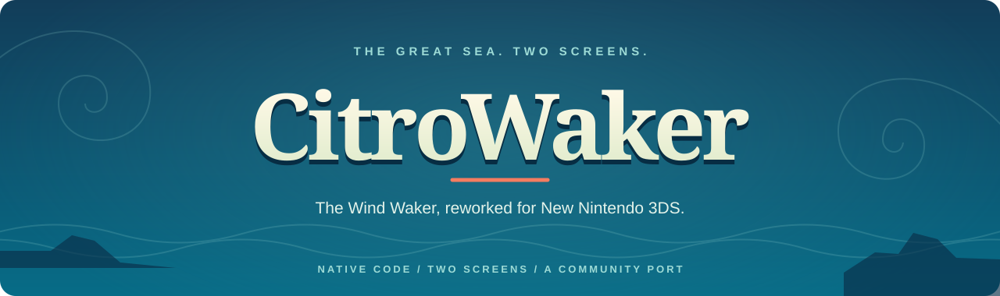

  

  <strong>The original GameCube adventure, brought to New Nintendo 3DS.</strong> 
  Native game code · Custom GX-to-PICA renderer · CIA delivery

  <a href="#development-status">Status</a> ·
  <a href="#getting-started">Getting started</a> ·
  <a href="docs/PERFORMANCE.md">Performance</a> ·
  <a href="QOL.md">QoL &amp; gyro</a> ·
  <a href="docs/DEVELOPMENT.md">Development guide</a>

## A handheld voyage

**CitroWaker** is an experimental native port of *The Legend of Zelda: The Wind Waker* for the **New Nintendo 3DS family**. It builds on the Wind Waker decompilation, SwitchWaker and Aurora, with a renderer built for the 3DS graphics hardware.

The aim is to preserve the original game's world, effects and behaviour while making its controls and presentation fit a handheld. Previously developed under the working name **Project Windfall**.

## From the development build

<table>
  <tr>
    <td width="50%"></td>
    <td width="50%"></td>
  </tr>
  <tr>
    <td align="center">Across Outset's rope bridge</td>
    <td align="center">The coast and lookout</td>
  </tr>
</table>

*Unmodified 400 × 240 development captures from Azahar, November 12, 2026. These show the port running in an emulator; they do not establish console performance or hardware rendering correctness.*

## Development status

**Active development. Not yet a finished release.** The port boots and reaches gameplay on real New 3DS hardware, but full-game completion has not been verified.

| Area | Where it stands |
|---|---|
| Game, audio and controls | Gameplay and sound run; Circle Pad movement, C-stick camera and physical remapping are implemented. |
| Rendering and performance | Working renderer, with remaining hardware depth, cloud and other visual faults. Heavy scenes still need optimization. |
| Saves | SD-backed memory cards are implemented; save-related failures have been reported. Preserve backups. |
| Touchscreen and QoL | Map routing, customizable shortcut configuration, optional QoL and gyro aiming are development features. Integration and hardware validation vary by feature. |
| Releases and source | This repository currently hosts documentation, showcase images and an offline timing-overlay tool. No downloadable CIA or self-contained source/build release is published here yet. |

See the [measured performance notes](docs/PERFORMANCE.md) and [console findings](docs/CONSOLE_FINDINGS.md) for build-specific evidence. Emulator timing is kept separate from real-console FPS.

## Getting started

The target is **New Nintendo 3DS-family hardware**, including New 3DS XL and New 2DS XL. Original 3DS/2DS systems are not supported targets.

You will need your own compatible **USA GameCube disc image (`GZLE01`)**, locally prepared game-data bundles, and a system capable of installing homebrew CIAs. The project supplies no ISO, extracted game assets or Nintendo music.

For an experimental build you already have:

1. Prepare the game-data folder at `/3ds/ww3ds/` using your own disc image and locally generated bundles.
2. Install the CIA, exit the installer, and launch the title from the HOME Menu.
3. Preserve `/3ds/ww3ds/user/` when updating—it contains your saves.

**The name change does not change existing SD paths:** `ww3ds`, `GZLE01.iso` and existing configuration filenames remain in use. A CIA does not contain or replace the game's SD data.

[Full data layout, installation and build prerequisites →](docs/DEVELOPMENT.md#installation)

## Made for the handheld

- **Circle Pad + C-stick:** movement and camera controls on the hardware's own inputs.
- **Physical remapping:** optional `buttons.ini` profiles.
- **Bottom-screen work:** a live-map routing backend and configurable item-shortcut design, still undergoing integration.
- **Optional conveniences:** sailing, grappling, text and song-replay hooks; gyro aiming is opt-in and still needs physical sensor validation.

Read [QoL and gyro configuration](QOL.md) and [touch shortcut status](SHORTCUTS.md) before relying on an experimental feature. Source implementation alone does not mean every previously distributed CIA includes it.

## Cutscene showcase tool

A [standalone Python + FFmpeg tool](tools/showcase/README.md) adds a measured frame-time graph and FPS counter below recorded footage. The game's ending cutscene now boots and renders in the port; the Ganondorf battle has not been captured yet. Emulator, console and host timing are explicitly distinguished.

*The ending cutscene in Azahar with the overlay's frame-time footer. Timing is emulator ("virtual") timing, about 29.4 FPS on average for this scene; the real console is slower.*

## What's next

The main priorities are **hardware rendering correctness, full-frame performance and stability**. Work includes a direct model-rendering path and PC-side preparation of game data. These are development goals, not promised speedups or completed features.

The [development guide](docs/DEVELOPMENT.md) covers the current build arrangement, controls, testing and asset boundaries. The repository is not yet a fresh-clone build of the port.

## Built on the community's work

[zeldaret/tww](https://github.com/zeldaret/tww) · [SwitchWaker](https://github.com/centollOS/SwitchWaker) · [Aurora](https://github.com/encounter/aurora) · [devkitPro](https://devkitpro.org/) · [Azahar](https://github.com/azahar-emu/azahar)

*The Legend of Zelda and The Wind Waker belong to Nintendo. CitroWaker is an independent community project and is not affiliated with or endorsed by Nintendo. Screenshots contain game imagery; no licence over Nintendo's assets is granted. Upstream components retain their own licences. See [repository scope and rights](RIGHTS.md).*
